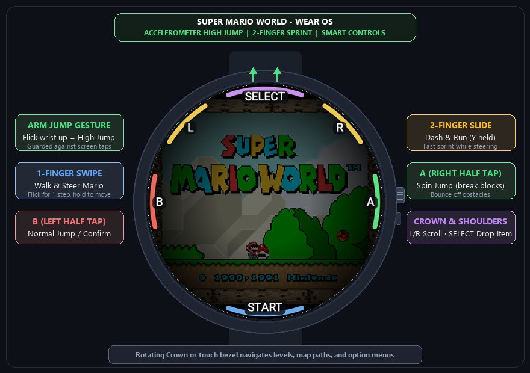

# Super Mario World (SMW) - Android & Wear OS Ports

A native port of **Super Mario World** (SNES) to Android phones, tablets, and **Wear OS smartwatches**, based on the C/C++ decompilation by [snesrev/smw](https://github.com/snesrev/smw).

<p align="center">
  
</p>

---

## ⌚ Wear OS Smartwatch Port (`:wear`)

Play Super Mario World on your wrist (Galaxy Watch, Pixel Watch, Xiaomi Watch 2, etc.):

- **🤸 Arm Gesture / Accelerometer High Jump**: Flick your wrist/arm upward to execute a full Mario High Jump. Protected by a 600ms touch guard so finger movements never misfire.
- **🏃 2-Finger Dash & Run (Mario Run)**: Slide with two fingers to run and steer simultaneously while automatically holding `Y`.
- **🕹️ 1-Finger Dynamic D-Pad**: Move smoothly; the control anchor follows your thumb.
- **🎮 Circular Rim HUD**: `B` (Normal Jump), `A` (Spin Jump), `L` / `R` (Scroll View), `SELECT` (Drop Reserve Item), `START` (Pause).
- **⌚ Rotary Crown / Touch Bezel**: Scroll through maps and level select menus.

### Building Wear OS APK
```bash
./gradlew :wear:assembleDebug
```
Output: `wear/build/outputs/apk/debug/wear-debug.apk`

### Installing on Watch via ADB Wi-Fi
```bash
adb connect <WATCH_IP>:<PORT>
adb install -r wear/build/outputs/apk/debug/wear-debug.apk
```

---

## 📱 Android Phone / Tablet Port (`:app`)

### Building Phone APK
```bash
./gradlew :app:assembleDebug
```
Output: `app/build/outputs/apk/debug/app-debug.apk`

---

## 📦 Game Assets Setup

The game requires `smw.dat` extracted from your legally owned ROM:
1. Place `smw.dat` into:
   `/storage/emulated/0/Android/data/net.freyta.smw/files/smw.dat`
2. Run the game once to create the directories and configuration files (`smw.ini`).

---

## 📜 Credits & Acknowledgments

- Original game by **Nintendo** (1990).
- C/C++ native decompilation by [snesrev/smw](https://github.com/snesrev/smw).
- Original Android port by [freyta/smw-android](https://github.com/freyta/smw-android) (credited to Waterdish & yeticarus).
