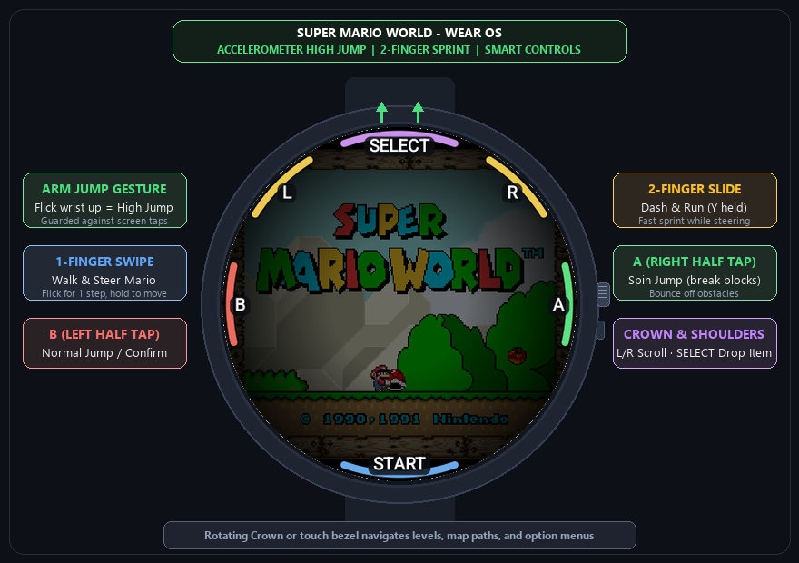

# Super Mario World (SMW) - Wear OS Port

A native C/C++ port of **Super Mario World** (SNES) running smoothly on **Wear OS smartwatches** (Samsung Galaxy Watch 4/5/6/7/Ultra, Google Pixel Watch 1/2/3, Xiaomi Watch 2, etc.), based on the native decompilation `snesrev/smw` and Android wrapper `freyta/smw-android`.

<p align="center">
  
</p>

---

## ⌚ What We Ported & Built for Wear OS

We brought the complete 16-bit masterpiece to round smartwatch screens with custom gesture recognition, smart touch overlay, and motion controls:

- **🤸 Arm Gesture / Accelerometer High Jump**: A deliberate upward arm or wrist flick triggers a full High Jump. Includes an intelligent 600ms touch guard so normal finger walking and button presses never cause accidental jumps.
- **🏃 2-Finger Dash & Run (Mario Run)**: Slide with two fingers across the screen to steer Mario while automatically holding `Y` (Run / Pick up Shells / Dash).
- **🕹️ 1-Finger Virtual Analog**: Flick for a single step or drag and hold to walk continuously. The anchor point smoothly trails your finger so your thumb never obstructs the screen.
- **🎮 Circular Rim Touch Controls**:
  - **`B` (Left half)**: Normal Jump / Menu Confirm
  - **`A` (Right half)**: Spin Jump (break turn blocks, bounce off enemies and hazards)
  - **`L` / `R` (Top Shoulders)**: Look and scroll the camera left / right
  - **`SELECT` (Top Center)**: Drop your reserve item (Mushroom, Fire Flower, Cape Feather)
  - **`START` (Bottom Center)**: Pause / Unpause the game
- **⌚ Rotary Crown & Touch Bezel**: Spin the watch crown or bezel to navigate world map paths, level selection, and options.
- **📳 Haptic Feedback**: Subtle vibration feedback on button presses and actions.
- **📸 Built-in Print / Showcase Mode**: A developer toggle (`SHOW_CONTROLS_FOR_PRINT = true`) applies a dark vignette and keeps all control HUD elements visible for promotional screenshots.

---

## 🚀 How to Build & Install for Wear OS

### 1. Build the APK
```bash
./gradlew :wear:assembleDebug
```
Output: `wear/build/outputs/apk/debug/wear-debug.apk`

### 2. Install on Watch via ADB Wi-Fi
```bash
adb connect <WATCH_IP>:<PORT>
adb install -r wear/build/outputs/apk/debug/wear-debug.apk
```

### 3. Game Asset Setup
Extract the `smw.dat` file from your legally owned ROM and place it into:
`/storage/emulated/0/Android/data/net.freyta.smw/files/smw.dat`
Running the app once automatically creates the target folder.

---

## 📜 Credits

- Original game by **Nintendo** (1990).
- C/C++ native decompilation by [snesrev/smw](https://github.com/snesrev/smw).
- Android frontend by [freyta/smw-android](https://github.com/freyta/smw-android).
- Wear OS port, accelerometer jump gesture, and circular controls by **Gustavo Lara** ([@gusdslara](https://github.com/gusdslara)).
